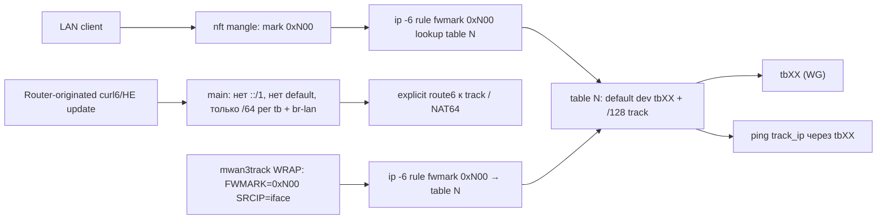

# План: mwan3 IPv6 policy switching

> **Дата плана:** 16 июля 2026  
> **Источник:** сессия Cursor (CreatePlan «mwan3 IPv6 policy switching»)  
> **Проект:** `project/mwan3`  
> **Статус реализации:** код и unit-тесты — **сделано**; полный LAN switch-тест — **отложен**; prod UCI — **не трогали**

---

## Статус todos (по итогам сессии)

| № | id | Содержание | Статус |
|---|-----|------------|--------|
| 1 | `read` | Анализ mwan3 init order: ifup → sync_routes → mwan3track start | **done** |
| 2 | `verify_id2mask` | `mwan3_id2mask`: id 3 → 0x300, id 4 → 0x400 | **done** |
| 3 | `decide_default_location` | Место default-add: выбран **`track_host_routes.sh`** (+ belt в `create_iface_route`) | **done** |
| 4 | `patch_mwan3track` | WRAP: `FWMARK=$IFACE_MARK` (не `MMX_DEFAULT`) | **done** |
| 5 | `add_default_policy` | `mwan3_ensure_policy_default_route` → `default dev tbXX` в policy table | **done** |
| 6 | `test_dev` | openwrt-dev: `route_allowed_ips=0`, track online, main без `::/1` | **done** |
| 7 | `test_switching` | LAN curl ipv6_tb62 ↔ ipv6_tb63 | **deferred** (метрики туннелей; tb63 на lab disabled) |
| 8 | `memory_save` | EchoVault | **done** |

### Реализация (код)

| № | Файл | Что сделано |
|---|------|-------------|
| 1 | `files/usr/sbin/mwan3track` | WRAP использует `FWMARK=$IFACE_MARK`; `IFACE_MARK` через `mwan3_id2mask` после `mwan3_init` |
| 2 | `files/lib/mwan3/track_host_routes.sh` | `mwan3_ensure_policy_default_route` после sync `/128` |
| 3 | `files/lib/mwan3/mwan3.sh` | вызов ensure из `mwan3_create_iface_route` (IPv6); восстановлен source `sync_tunnel_metrics.sh` |
| 4 | `tests/test_track_host_routes.sh` | тесты policy default + id2mask |
| 5 | `Makefile` | `PKG_RELEASE:=7` |

**Почему default в `track_host_routes`:** hotplug `15-mwan3` при `FIRSTCONNECT=1` выходит до `create_iface_route`; sync перед ping — критичный путь.

### openwrt-dev (lab)

- У WG peers (кроме warp): `route_allowed_ips='0'`; main очищен от `::/1`.
- `network.tb63.disabled=1` — не включать для switch-тестов (как роль tb64 на prod).
- Метрики туннелей: `sync_tunnel_metrics` → 30/40 для 1st/2nd online member активной IPv6 policy.
- Prod: только tb63+tb64 активны (решение Пилота); полный набор — для openwrt-dev.

---

## Цель

Сделать так, чтобы mwan3 мог переключать IPv6-роутинг политикой (`ipv6_tb62`, `ipv6_tb63`, …) на prod при `route_allowed_ips=0` у всех tb, и `::/1` / `8000::/1` не присутствуют в `main` (у tb64 — metric 5, у tb65 — 10 в текущем проде тоже убираются). LAN forward переключается mark-политикой; router-originated (`ping/curl` с роутера, HE tunnel update) идёт в `main` только при наличии explicit routes (не policy-driven).

Принципиальные решения Пилота:

1. **Развязать mwan3track от main**: WRAP должен пинговать через policy table своего tb, а не main.
2. **Только LAN forward** переключается политикой; router-originated не участвует в policy.
3. **Полностью убрать `::/1` / `8000::/1` из main**; default IPv6 — только через mwan3 policy (mark-driven).
4. Default в policy table каждого tb положить через **mwan3 member/policy** (не `network.route6 ::/0` каждому tb).
5. Патчить `/usr/sbin/mwan3track` (fork nagual2 — наш) в одной строке WRAP.

## Контекст текущего поведения (на момент плана)

- mwan3track WRAP: `FWMARK=$MMX_DEFAULT` (= 0x3f00 → lookup main → IP rule 2001…2009 на fwmark ≠ default не матчит → `lookup main`).
- `mwan3_sync_routes` копирует `default`/`fe80::/64` из main в policy table только если tid совпадает с iface id. При `route_allowed_ips=0` в main нет default к tb → в policy table тоже нет.
- policy tables 3–9: `/128` track_ip, свой `/64`, `br-lan`, connected, но **не** default к `::/0`.
- IPv4 `ipv4_primary` работает; IPv4 track не должен пострадать.

## Архитектура метода



Ключ: одна и та же policy table обслуживает LAN (mark от mwan3_rules) и mwan3track (FWMARK через WRAP).

## Изменения (как в плане)

### 1. policy table: default при online

Варианты в плане:

- A: дополнить `mwan3_sync_routes` в `mwan3.sh`
- **B (выбрано):** `track_host_routes.sh` после `/128` + belt в `create_iface_route`

Прототип из плана (для справки):

```sh
# ensure default exists in policy table when iface is online
local _status
[ -f "$MWAN3TRACK_STATUS_DIR/$1/STATUS" ] && read -r _status < "$MWAN3TRACK_STATUS_DIR/$1/STATUS"
if [ "$family" = "ipv6" ] && [ "$_status" = "online" ] && \
   [ -z "$($IP route list table $id default 2>/dev/null)" ]; then
    $IP route add table $id default dev "$device" metric 1 2>/dev/null ||
        LOG debug "default already in table $id"
fi
```

### 2. mwan3track: FWMARK = per-iface mark

```sh
WRAP() {
    FAMILY=$FAMILY DEVICE=$DEVICE SRCIP=$SRC_IP FWMARK=$IFACE_MARK \
        LD_PRELOAD=/lib/mwan3/libwrap_mwan3_sockopt.so.1.0 $*
}
# после mwan3_get_iface_id:
mwan3_id2mask IFACE_MARK "$id" "$MMX_MASK"   # id 3 → 0x300, …
```

### 3. UCI: `route_allowed_ips=0` (не код)

| № | Действие | Где |
|---|----------|-----|
| 1 | У WG peers: `route_allowed_ips='0'` | `network.@wireguard_tb*` |
| 2 | Убрать `::/1`/`8000::/1` из main | автоматом после п.1 |
| 3 | Static `/128` track в main — не нужны | — |
| 4 | NAT64 route6 tb63 — **оставить** | `network.@route6` |
| 5 | `mwan3.default_rule_v6.use_policy` — как есть | mwan3 |

На **openwrt-dev** п.1–2 сделаны. На **prod** — только по отдельному запросу.

## Побочные эффекты / trade-offs

| № | Эффект | Оценка |
|---|--------|--------|
| 1 | Нужен default в table N до успешного WRAP; риск race firstconnect | среднее → mitigated via track_host_routes |
| 2 | Первый ping до default → ложный offline | низкое (`up`/`down`) |
| 3 | Router-originated без `::/1` в main — только explicit route6; fallback default в main — с Пилотом | уточнение |
| 4 | mwan6-npt — не зависит | — |
| 5 | IPv4 — не затрагивается | — |
| 6 | Gismeteo/NAT64 — explicit routes | — |

## Файлы анализа (до реализации)

| № | Файл | Зачем |
|---|------|-------|
| 1 | `files/lib/mwan3/common.sh` | `mwan3_id2mask`, MMX_MASK |
| 2 | `files/lib/mwan3/mwan3.sh` | ifup → sync → track |
| 3 | `files/lib/mwan3/track_host_routes.sh` | место default |
| 4 | `src/sockopt_wrap.c` | SO_MARK с fwmark 0x300… |

## Проверки

| № | Проверка | Команда / результат |
|---|----------|---------------------|
| 1 | track online после restart | `mwan3 status` — на lab online TB OK |
| 2 | `default` + `/128` в table N | `ip -6 route show table N` |
| 3 | main без `::/1` | `ip -6 route show \| grep …` — на lab OK |
| 4 | switch policy + LAN curl | **отложено** |
| 5 | router-originated curl -6 | зависит от explicit routes |
| 6 | NAT64 Gismeteo | explicit route6 |
| 7 | unit tests | `tests/test_track_host_routes.sh` — 7 passed |

## Что НЕ делается (по плану)

- IPv4 политика — без изменений.
- mwan6-npt / firewall — без изменений ради этого метода.
- Prod UCI — только по отдельному запросу.
- Dual-source `.ai`/`.md` — для новых скриптов по `agent-dual-source`.

## Открытые пункты

| № | Пункт |
|---|--------|
| 1 | Полный LAN switch-тест на openwrt-dev (после стабильных метрик / политики) |
| 2 | Деплой пакета `PKG_RELEASE=7` и UCI `route_allowed_ips=0` на **prod** — по запросу Пилота |
| 3 | Нужен ли fallback `default` в main для router-originated IPv6 |

---

*Копия Cursor plan: `~/.cursor/plans/mwan3_ipv6_policy_switching_*.plan.md` (локально у агента). Канон в репо — этот файл.*
